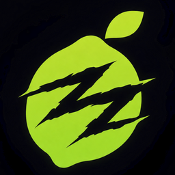

# ZestZero — Legal AI Security Assurance



**Never assume. Always verify.** Independent portfolio laboratory for legal information barriers and reproducible GRC evidence.

## Why
Chile's FNE merger review illustrates the need to separate commercially sensitive information. Harvey's public engineering documentation describes enforcing legal-matter barriers on AI-derived content. LemonTech's public policy references information security, privacy and AI governance. See [case and controls](docs/case.md). None of these organizations is being tested; all private documents, identities and intentional defects are synthetic.

## Run
```bash
python3 -m venv .venv
source .venv/bin/activate
python -m pip install -r requirements.txt -r requirements-ml.txt
python -m pytest -q
python -m app.assurance
python -m app.playground
python -m uvicorn app.main:app
```
Open http://127.0.0.1:8000. Baseline and corrected modes show actual Python results. Click each check to inspect evidence; export JSON. Local fresh runs use the API. GitHub Pages serves CI-generated snapshots, not a live backend. Configure Settings → Pages → Source → GitHub Actions, then run the “Publish public evidence demo” workflow manually from the Actions tab. The workflow publishes the committed benchmark snapshot and regenerates synthetic security results.

## Architecture
1. `app/sandbox.py`, `data/case.json`: deterministic retrieval, current permissions and source lineage.
2. `app/assurance.py`, `tests/`: nine security scenarios, evidence fingerprints, release recommendation.
3. `app/main.py`, `site/`, `.github/workflows/`: API, dashboard and CI publication.

## Limits
No LLM, no real authentication, no production deployment. The optional evidence-ranking benchmark is separate from the security fixture. Extractive retrieval is by fixed topic; access enforcement is tested within a controlled backend fixture. SHA-256 fingerprints are not digital signatures or tamper-proof logging. The public FNE context is a paraphrase; no actual contracts are bundled. The deliberately defective fixture must never handle real documents. Control mappings are indicative and not certification. A passing run is a recommendation for human review, not release approval.

## ContractNLI evidence benchmark (v0.3)
Read the [official dataset terms](https://stanfordnlp.github.io/contract-nli/) and download its original ZIP if you agree. Then run:
```bash
python -m pip install -r requirements-ml.txt
python -m app.benchmark ~/Downloads/contract-nli.zip
```
The benchmark trains a small supervised span ranker on the official training split and compares it against lexical overlap on the untouched test split. It measures Hit@1, Hit@3 and macro Recall@3 on queries with annotated evidence. No raw text is exported: only aggregate metrics, span IDs and provenance. The fixed 17 hypothesis types are shared across splits by design. This is not an NLI classifier, semantic LLM, or a measure of confidentiality. It is separate from the nine synthetic security checks; their results must never be pooled. The public dashboard shows `site/benchmark.json`, and reports a not-run state until the actual evaluation completes.

Dataset: Yuta Koreeda and Christopher D. Manning, *ContractNLI: A Dataset for Document-level Natural Language Inference for Contracts*, Findings of EMNLP 2021, https://aclanthology.org/2021.findings-emnlp.164/ . Dataset CC BY 4.0, https://creativecommons.org/licenses/by/4.0/ . Derived benchmark metrics only; the original documents are not redistributed.

## Recorded benchmark
The local run reported on 2026-11-24 used 423 training contracts, 123 test contracts and 1,188 annotated test queries. See the generated [benchmark record](site/benchmark.json) for provenance, exact metrics and scope.

| Retrieval method | Hit@1 | Hit@3 | Macro Recall@3 |
| --- | ---: | ---: | ---: |
| Lexical overlap | 36.2% | 58.2% | 41.4% |
| TF-IDF + supervised logistic regression | 82.8% | 94.9% | 80.3% |

These are measurements of evidence ranking for the fixed ContractNLI hypothesis set against its official annotated candidate spans, excluding NotMentioned queries. They are not measurements of general-purpose retrieval, answer correctness or security.

## Interactive confidentiality playground
Select an identity, a query and a document or derived-summary operation. The public site explores the 96 combinations actually executed by the Python sandbox (two configurations × four identities × four topics × three operations); the local API can run a selected combination again. The playground intentionally exposes fictional returned text so the user can understand a disclosure. It is separate from the nine recorded release checks and the ContractNLI benchmark, and never accepts external documents or real identities. Revocation concerns the selected restricted matter; the public context is not revoked. These simulated identities are not production authentication. Remediation owners and review status are proposed, not actual assignments or formal closure.


<!-- BEGIN ZESTZERO GRC DOCUMENTATION -->
## GRC operations and ISMS documentation

The independent portfolio laboratory includes a draft operational GRC documentation pack, with indicative ISO/IEC 27001:2022 references:

- [GRC Security Register (XLSX)](docs/grc/security-register.xlsx): asset inventory, risk assessment, risk treatment, third-party due diligence, customer security questionnaires, audit evidence, incident records and security KPIs / SLA tracking.
- [ISMS documentation](docs/grc/isms-documentation.md): scope, proposed policies and procedures, document version control, LATAM privacy, secure AI use and maintainer validation.

The pack links the recorded laboratory checks to GRC exercises. Risk scores, supplier responses, incidents and SLA examples are simulated. A passing retest does not constitute formal closure, risk acceptance or release approval. No certification, enterprise ISMS implementation or real supplier audit is claimed.
<!-- END ZESTZERO GRC DOCUMENTATION -->

---

© 2026 Jofran (@ht4) — ZestZero.
Independent cybersecurity portfolio project.
